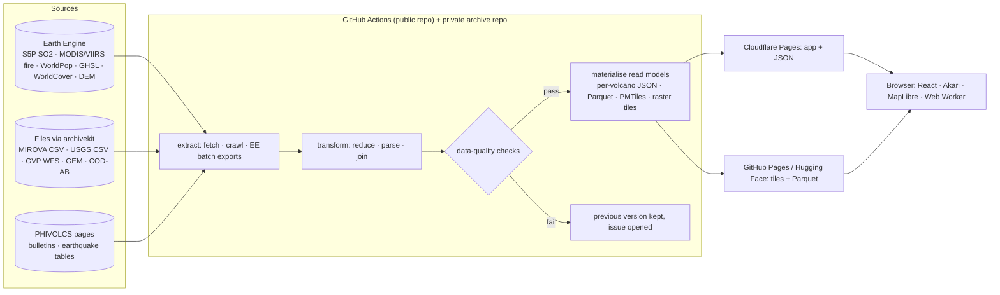

# Architecture options

Status: 2026-10-21, proposal for the recommended candidate (volcanoes; [CANDIDATES.md](CANDIDATES.md)). Nothing is implemented. Versions and limits were checked on the day ([`research/platform-limits.md`](research/platform-limits.md)); **[U]** marks estimates. Kurt's standing preference applies: a widely recognised, named pattern, customised for this project, with the "standard → our variant" mapping written down ([architecture preference](../../CLAUDE.md) §7).

Constraints: free tiers only; Akari for the UI; `archivekit` for every external source; static-first (the live app never depends on an upstream or on a sleeping server); English and Japanese; the safety rules in [RESEARCH.md](RESEARCH.md) §9 are part of the product, not of the UI layer alone; no heavy local computation (the pipeline runs in GitHub Actions and Earth Engine).

> **Decided 2026-10-21 (Q3, Q4 in [DECISIONS.md](DECISIONS.md)): Option B from the start.** The static read models of option A carry the map and the per-volcano views; the read-only Java 17 Spring Boot (MyBatis) API on PostGIS is part of milestone 1, behind a same-origin Cloudflare Pages function with mandatory edge caching, on Render free beside Replay's service and on its own Neon free project. The front end is React 19 (Vite, Akari, MapLibre). No Rust. The text below is kept as written history: §2 still says "milestone 2 or 3" for the API, which is superseded; the free-tier constraints that follow from the decision are in [DATA-PLAN.md](DATA-PLAN.md) §8 and the extra spike items in [SPIKE-PLAN.md](SPIKE-PLAN.md) items 13–18.

## 0. Recommendation at a glance

**Option A, "static read models": Jamstack delivery of CQRS-style materialised read models built by a Python pipeline in GitHub Actions (Earth Engine for rasters), a React + Akari + MapLibre front end, and client-side recompute in a Web Worker.** No server at milestone 1. Option B adds a Java read API over PostGIS (Neon, Render free) as a later "Under the hood" milestone, because the domain (dated events in space) is relational and Java is Kurt's day job; the static site never depends on it. Option C (a Rust core with CLI, WASM and Worker adapters, Lights' architecture) is rejected for this project: the browser-side maths is light, so a shared compiled core would be a repeat of Lights without a measured need.

| | A: static read models | B: A + Java read API (milestone 2+) | C: Rust core, three adapters |
|---|---|---|---|
| Named pattern | Jamstack + Materialised View (the read side of CQRS); pipeline as an ETL batch layer | A plus Hexagonal (ports and adapters) Spring Boot service, read-only | Hexagonal Rust core + CQRS read models + Jamstack (Lights) |
| Runtime cost | $0, cannot bill | $0 while within Render free; overages would bill (card on file), so edge caching is mandatory | $0 |
| Shows off | Earth Engine pipelines, multi-sensor fusion, provenance, honest UI, bilingual | plus Java 17/Spring on PostGIS with spatial-temporal queries and OpenAPI | plus Rust/WASM parity |
| Risk | low | Render sleep, bandwidth | a repeat of Lights; toolchain time |
| Verdict | **build first** | **plan as milestone 2 or 3** | not here |

## 1. What the system has to do

1. **Ingest** about a dozen sources of four shapes: rasters on Earth Engine (TROPOMI, MODIS/VIIRS fire, WorldPop, GHSL, WorldCover, DEM), tabular files (MIROVA CSV, USGS CSV, GVP WFS CSV, GEM GeoJSON, COD-AB), crawled HTML (PHIVOLCS bulletins and earthquake tables), and later InSAR GeoTIFFs.
2. **Reduce** rasters to per-volcano daily series and national monthly mosaics; **parse** bulletins into dated fields; **join** everything on (volcano, date).
3. **Derive** honest summaries: episodes (eruption windows from GVP, alert windows from bulletins), baselines and anomalies per series, coverage fractions, exposure rings; plain-language readings in English and Japanese.
4. **Publish** immutable data versions (tables, tiles, JSON), with provenance and "data as of".
5. **Serve** a map of 24 volcanoes, a per-volcano multi-series view with a time scrubber, a national layer by month, and the methods/about pages, in two languages, with the safety banner, from a CDN.
6. **Recompute** small things interactively (ring radius 10/20/30 km, hotspot confidence threshold, baseline window) from pre-aggregated bins, in the browser.

None of this needs a request-time server. The interactive recompute works on per-day, per-annulus bins (6 annuli × 2,900 days × a few fields per volcano), which is thousands of numbers, not millions.

## 2. Option A (recommended): static read models

### 2.1 Pattern and customisation

- **Jamstack**: "the entire front end is prebuilt into highly optimized static pages and assets during a build process" and served from a CDN ([jamstack.org](https://jamstack.org/what-is-jamstack/)).
- **Materialised View / CQRS read side**: precomputed views "store the results of complex computations or queries without requiring the database engine or client to recompute for every request" ([Azure Architecture Center](https://learn.microsoft.com/en-us/azure/architecture/patterns/materialized-view)); as in Lights, only the read half of CQRS is used, because the only write is the pipeline run.
- **ETL batch layer**: the pipeline is a classic extract-transform-load batch in GitHub Actions, with Earth Engine as a remote compute engine for rasters.

| Standard vocabulary | This project | Customisation and reason |
|---|---|---|
| Extract | `archivekit.fetch()` for every file source; a polite crawler (≤ 1 request/s, per-era parsers) for PHIVOLCS pages; Earth Engine batch exports to Drive for raster reductions | Rasters are never downloaded: they are reduced where they live. Crawled pages are bundled and archived as releases (the "adopt a local bundle" path Lights used for the PSA file) |
| Transform | Python (uv): pandas/pyarrow for tables, exactextract only for the InSAR milestone, text parsers with fixtures per bulletin era | Python because the Earth Engine client is Python; the parsers are the risky code and get the most tests |
| Load / materialise | a `read-models` step writes per-volcano JSON (series + episodes + readings), national Parquet tables, PMTiles (volcano points, hotspots, earthquakes, rings), monthly SO2 raster tiles | Immutable `v<N>/` folders with a `latest.json` pointer flipped only after checks pass (archiving standard §5) |
| Serve | Cloudflare Pages (app + per-volcano JSON); GitHub Pages primary and Hugging Face fallback for tiles and Parquet (Lights' Q5 pattern) | Pages' 25 MiB per-file cap is respected by splitting tiles per layer and raster mosaics per year |
| Client | React 19 + Akari + MapLibre GL 6; a Web Worker (TypeScript) for ring/threshold recompute from bins; charts in Akari's chart layer | deck.gl (`@deck.gl/maplibre`, 9.4) only if the spike shows MapLibre's circle/heatmap layers cannot animate the hotspot layer well enough (SPIKE-PLAN item 7); otherwise not added |

### 2.2 Diagram



### 2.3 Performance and size targets [U until the spike]

- First view (national map): app bundle about 300 kB gz, volcano points and rings under 50 kB, basemap tiles from the Lights basemap source; under 1 s on a warm connection from Manila (Lights measured 36–50 ms p50 to Pages from PH).
- Per-volcano view: one JSON per volcano, about 2,900 days × about 12 fields plus bins, about 400 kB raw, under 80 kB gz; charts render in one frame.
- Hotspot layer: 100k–400k points as PMTiles, 5–15 MB total, loaded by tile, never whole.
- National monthly SO2 mosaics: 95 months × a small raster tileset (z0–7 over the Philippines), under 1 MB each, under 100 MB total, split per year to respect the 25 MiB cap.

### 2.4 Why not a database at milestone 1

The read models are small, the writes are one batch a week, and a sleeping free database would make the app depend on it. The archiving standard's rule "the live app never depends on an upstream source at runtime" applies to our own services too.

### 2.5 Risks

- Earth Engine batch exports to Drive from a service account: documented behaviour is thin [U]; the spike tests it, with `computeFeatures`/table `getInfo` under 100 MiB as the fallback.
- PHIVOLCS page formats change by era; mitigated by per-era parsers with committed fixtures and by archiving the raw HTML bundles.
- MapLibre-only animation of hundreds of thousands of points may stutter; the spike measures it and deck.gl is the fallback.

## 3. Option B: A plus a Java read API (milestone 2 or 3)

### 3.1 Pattern

Hexagonal (ports and adapters) Spring Boot service, read-only, over a PostGIS schema loaded by a Java batch, the same shape Typhoon Replay's Java API has (`../../typhoon-replay/docs/architecture/DECISIONS.md`). Driving adapters: HTTP (OpenAPI), the static materialiser (optional). Driven adapters: the PostGIS repository.

| Hexagonal vocabulary | This project |
|---|---|
| Application core | the event catalogue: volcanoes, eruptions (GVP), bulletins (PHIVOLCS), earthquakes (USGS, PHIVOLCS), thermal detections, SO2 days, episodes; spatial-temporal queries ("events within 30 km of Taal between dates", "what happened in the 14 days before each VEI ≥ 3 eruption since 2000") |
| Driving adapters | Spring MVC controllers with OpenAPI; a CLI that exports the same JSON the static site uses (contract test: API JSON equals static JSON) |
| Driven adapters | JdbcClient or MyBatis mappers over PostGIS (Neon free, 1 GB; the catalogue measured about 220 MB with indexes in spike Run 2) |
| Deployment | Render free (Singapore), same-origin `/api/*` through a Pages function, edge-cached public reads with long TTLs; the static site must work with the API deleted |

### 3.2 Why it earns its place

The domain is dated events in space: joins across catalogues, windows around eruptions, nearest-volcano queries. That is what PostGIS and a relational model do well, and it mirrors Kurt's day job (Java 17, MyBatis) in a way the Python pipeline does not. It is deferred because visitors never need it and Render's sleep and overage rules make it a showcase, not a dependency.

### 3.3 Cost and risk

Render free sleeps after 15 minutes; bandwidth overages would bill because a card is on file, so every public read is edge-cached and the API is rate-limited. Neon free's 1 GB holds the catalogue (USGS 27k rows, thermal detections up to 400k, daily rows 235k, ring bins about 1M: about 220 MB with indexes, measured in spike Run 2; the M1 queries run in under 0.3 ms). Spike Run 2 also measured the JVM at Render free's 0.1 CPU: about 78 s to `/readyz` with CDS, before Render's wake, RSS about 190 MB (DECISIONS.md S7).

## 4. Option C: Rust core with CLI, WASM and Worker adapters (not recommended here)

Lights' Architecture B: a `no_std`-friendly Rust crate holding the derived-series maths (baselines, anomaly scores, episode detection, ring aggregation), driven by a CLI in CI, a WASM build in the browser and a Cloudflare Worker API, with bit-identical results in all three.

Why not: the browser-side maths here is a sum over a few thousand bins and a running median; it does not need a compiled core to be fast or to match CI (a shared TypeScript module tested against the pipeline's fixtures is enough). Building the same three-adapter design a second time would show nothing new and cost toolchain time. If a later milestone adds heavy client-side work (for example interactive InSAR time-series inversion over a cropped frame), Rust/WASM becomes the right tool and this option is reopened.

## 5. Front end (common to A and B)

- **Stack:** Vite, React 19, TypeScript, `@abrycta/akari` (components, tokens, theme toggle with the shared cookie and `theme-init.js`, high-contrast button), MapLibre GL JS 6.15, PMTiles 4.5, Akari's chart layer; i18n EN/JA as in Lights (captions first).
- **Views:** (1) the national map: 24 volcanoes, a month scrubber (2000-01 → snapshot) driving the thermal detections and SO2 mosaic layers, rings on hover, GVP "last eruption" and "eruptions since 1900" per volcano; (2) the volcano page: synchronised charts (GVP eruptions as VEI bars; alert-level history as a step line "as reported by PHIVOLCS"; PHIVOLCS SO2 flux and TROPOMI SO2 mass with coverage shading; thermal detections, FRP and MIROVA VRP; earthquakes within 30 km as a strip; deformation statements as markers; later InSAR), an episode list with plain-language readings, exposure rings, sources and limits; (3) About/Methods: every proxy explained, the safety rules, attributions, data as of.
- **Safety UI:** the banner is a layout element present on every route; no component renders "current" status; the snapshot date is in the header and on every chart.
- **Interaction:** scrubbing is client-side over the loaded JSON; ring radius and thresholds recompute in the Worker; nothing is fetched from a server at interaction time.

## 6. Milestone 1 scope and the 60-second demo

**Milestone 1 (ship):** 24 volcanoes on the map; full series for Taal, Mayon, Kanlaon, Bulusan (bulletins + satellites + earthquakes + GVP + exposure); satellite, GVP, earthquake and exposure series for the other 20; national thermal-detection layer by month; TROPOMI SO2 mass per volcano and a national monthly SO2 mosaic (2018-12 → ); MIROVA VRP where available; alert-level history 2017 → from bulletins; episodes and plain-language readings; EN/JA; data version v1 with provenance; the project page and share card.

**Deferred:** InSAR (milestone 2: COMET link at M1, LiCSBAS crop at Taal later); the Java API (milestone 2 or 3); ISC catalogue; GVP weekly reports for 2000–2017 PHIVOLCS figures; OMI/OMPS SO2 before 2018.

**60-second demo:** open Taal; scrub to January 2020: USGS and PHIVOLCS earthquake counts climb, the alert level steps 1 → 2 → 3 → 4 on 12 January, the 15 km TROPOMI SO2 band spikes on 12–13 January with the coverage bar showing which days were cloud-free, thermal detections appear on the island, GVP marks VEI 4, exposure shows about 459,000 people within 14 km (OCHA's figure beside the WorldPop count); the reading says, in plain words and with the limits, what each instrument saw and what it cannot say. Then switch to Kanlaon and scrub to September 2024, where PHIVOLCS's record 11,556 t/day flux sits beside the satellite mass and its coverage.

## 7. Repository layout (proposal)

```
<name>/
  pipeline/        Python (uv): sources.yaml, archivekit hooks, crawlers, parsers, ee/, read-models/, tests/
  web/             Vite + React + Akari + MapLibre; src/{app,map,volcano,charts,i18n,lib,worker}
  data/            fixtures only (small, licence-checked); outputs are published, not committed
  docs/            this folder; architecture notes move to docs/architecture/ when built
  spike/           throwaway (outputs gitignored)
  .github/workflows/   checks.yml (pipeline tests, web build), data.yml (full run, manual + weekly)
```

A private `abrycta/<name>-archive` repo holds the raw snapshots (archiving standard §3).
